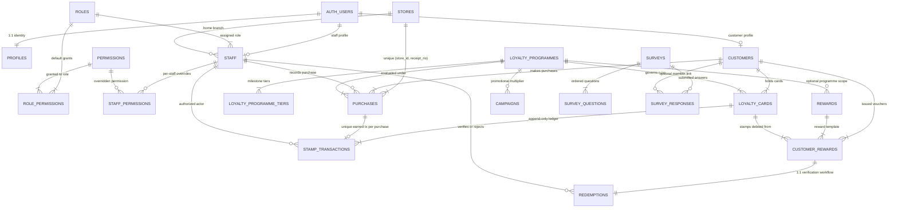

# BONFREE-HUB — Database Entity Relationship Documentation

## 1. Entity Relationship Diagram

---

## 2. Core Integrity & Security Constraints

| Constraint / Mechanism | Table(s) | Purpose |
| --- | --- | --- |
| `UNIQUE (store_id, receipt_no)` | `purchases` | Prevents reusing the same POS receipt number at a store. |
| `UNIQUE (purchase_id) WHERE tx_type = 'earned'` | `stamp_transactions` | Guarantees stamps cannot be awarded twice for the same purchase. |
| `idempotency_key UNIQUE` | `stamp_transactions` | Safe retry protection for POS/Edge Function requests. |
| `trg_stamp_tx_immutable` | `stamp_transactions` | Blocks all `UPDATE`/`DELETE` operations on the stamp ledger. |
| `trg_audit_logs_immutable` | `audit_logs` | Blocks all `UPDATE`/`DELETE` operations on security audit logs. |
| `CHECK (current_stamps >= 0)` | `loyalty_cards` | Prevents negative stamp balances even under concurrency (`FOR UPDATE`). |
| `UNIQUE (customer_id, programme_id)` | `loyalty_cards` | Ensures one digital loyalty card per customer per programme. |
| `voucher_code UNIQUE CHECK ('^BFH-...')` | `customer_rewards` | Unique, non-guessable voucher codes (`gen_random_uuid` entropy). |
| `trg_guard_customer_self_update` | `customers` | Prevents customers from updating `membership_id` or `status` via RLS. |
| `SECURITY DEFINER` RPCs (`REVOKE ALL` from `anon`/`authenticated`) | `fn_award_stamps`, `fn_request_redemption`, `fn_process_redemption` | Guarantees all stamp & redemption mutations execute atomically inside PostgreSQL via `service_role` Edge Functions only. |
